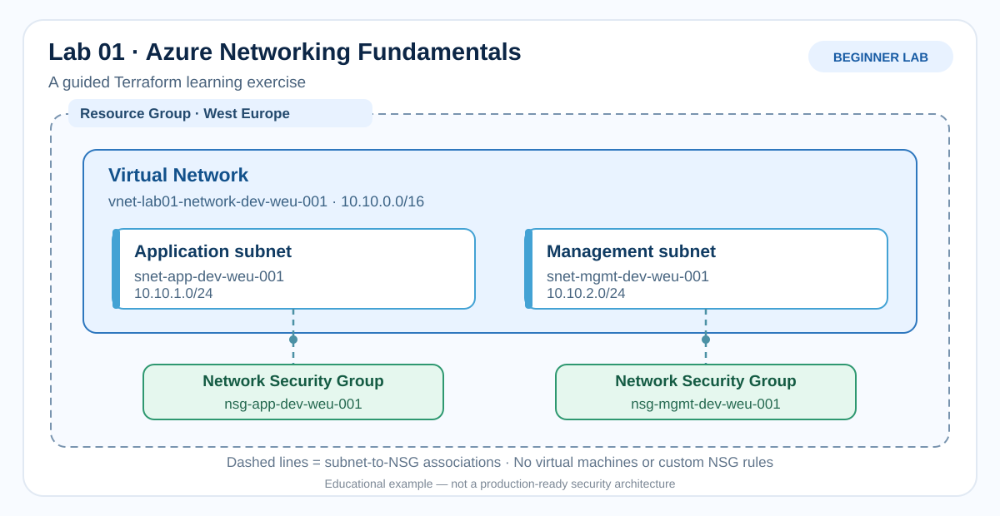

# Azure Terraform & DevOps Labs

**Solisys-Cloud** | Practical Azure Infrastructure as Code exercises with Terraform.

**Created and maintained by Solisys SRL, a senior Microsoft cloud consultancy.** This public repository shares practical, reusable training material for engineers and learners.

**Learning levels (Beginner / Intermediate / Advanced) describe the intended reader, not the author's professional experience.** The labs teach concepts through concrete examples, clear diagrams, and safe, repeatable exercises.

## Learning path

| Lab | Level | Focus | Status |
| --- | --- | --- | --- |
| [Lab 01 - Azure Networking Fundamentals with Terraform](labs/01-azure-networking/README.md) | Beginner | Resource group, VNet, subnets, NSGs, Terraform basics | Planning |

More labs will be added progressively, including reusable Terraform modules, GitHub Actions CI/CD, and Azure DevOps pipelines.

## Repository standards

- [Lab and Azure resource naming conventions](docs/naming-conventions.md)
- [Branch and pull request workflow](docs/git-workflow.md)
- All content is written in English.
- Each lab is designed as a tutorial, not merely a collection of scripts.
- Never commit secrets or Terraform state files.
- Azure deployment requires explicit manual approval; no Azure deployment is configured yet.

## Lab 01 visual overview

*Illustrative teaching architecture. Not a production network reference design.*

## Disclaimer

Training materials for personal technical learning and demonstration. Not a production-ready reference architecture.
