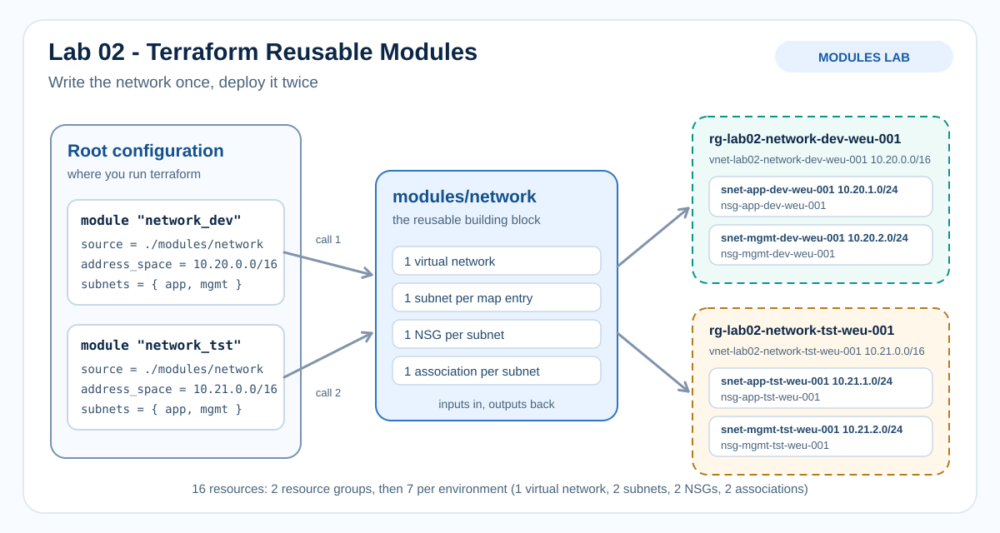

# Azure Terraform & DevOps Labs

**Solisys-Cloud** | Practical Azure Infrastructure as Code exercises with Terraform.

**Created and maintained by Solisys SRL, a senior Microsoft cloud consultancy.** This public repository shares practical, reusable training material for engineers and learners.

**Learning levels (Beginner / Intermediate / Advanced) describe the intended reader, not the author's professional experience.** The labs teach concepts through concrete examples, clear diagrams, and safe, repeatable exercises.

## Learning path

Labs are grouped in tracks. Inside a track, follow the steps in order.

### Track 1 - Terraform foundations

From a first network to a versioned, reusable module.

| Step | Lab | What you do | Level | Status |
| --- | --- | --- | --- | --- |
| 1 | [Lab 01 - Azure Networking Fundamentals with Terraform](labs/01-azure-networking/README.md) | Build a small Azure network by hand: resource group, virtual network, subnets, and network security groups. | Beginner | Deployed and tested |
| 2 | [Lab 02 - Terraform Reusable Modules](labs/02-terraform-reusable-modules/README.md) | Turn that network into a reusable module and deploy it for two environments. | Beginner to intermediate | Deployed and tested |
| 3 | [Lab 03 - Module Versioning](labs/03-module-versioning/README.md) | Consume the network module from Git with a pinned version, then upgrade it from v1.0.0 to v1.1.0. | Intermediate | Not yet deployed |

### Track 2 - DevOps and automation

From a laptop to a reviewed, approved pipeline.

Planned: Lab 04 - GitHub Actions CI/CD; Azure DevOps pipelines.

### Track 3 - Azure architecture

Network designs used in real landing zones.

Planned: Lab 05 - Azure Hub and Spoke Networking; a secured application network that extends Lab 01; a Bicep version of Lab 01.

## Repository standards

- [Lab and Azure resource naming conventions](docs/naming-conventions.md)
- [Branch and pull request workflow](docs/git-workflow.md)
- All content is written in English.
- Each lab is designed as a tutorial, not merely a collection of scripts.
- Never commit secrets or Terraform state files.
- Azure deployment is always manual and explicitly approved; no automated deployment is configured.

## Visual overview

*Illustrative teaching architectures. Not production network reference designs.*

## Disclaimer

Training materials for personal technical learning and demonstration. Not a production-ready reference architecture.
