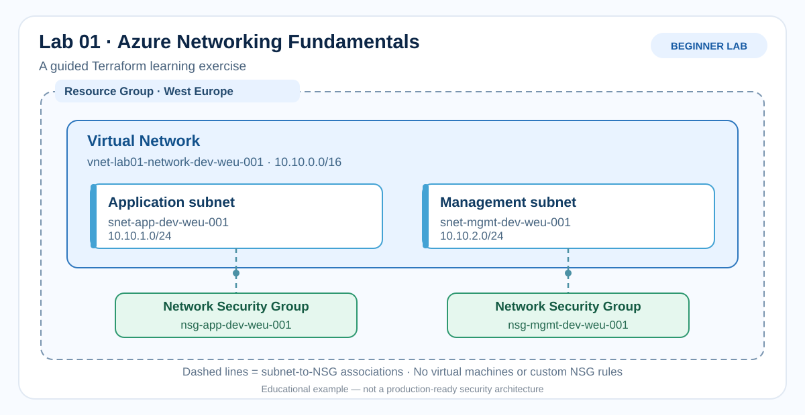

# Lab 01 - Azure Networking Fundamentals with Terraform

**Level:** Beginner  
**Technology:** Azure, Terraform  
**Focus:** Networking, Infrastructure as Code, fundamentals  
**Audience:** Beginners learning Terraform and Git-based DevOps workflows  
**Status:** Documentation and planning (no resources deployed)

## Goal

Learn how to describe and deploy a small Azure network using Terraform, with clear naming and step-by-step explanations.

## Target architecture



*Diagram: resource group, virtual network, two subnets, and subnet-to-NSG associations. Educational scope only.*

| Resource | Planned name | Configuration |
| --- | --- | --- |
| Resource group | `rg-lab01-network-dev-weu-001` | West Europe |
| Virtual network | `vnet-lab01-network-dev-weu-001` | `10.10.0.0/16` |
| Application subnet | `snet-app-dev-weu-001` | `10.10.1.0/24` |
| Management subnet | `snet-mgmt-dev-weu-001` | `10.10.2.0/24` |
| Application NSG | `nsg-app-dev-weu-001` | Azure default rules initially |
| Management NSG | `nsg-mgmt-dev-weu-001` | Azure default rules initially |

> **Security note:** Separate subnets with default NSG rules do not provide full network isolation. Rules, routing, and workloads will be considered explicitly in later labs.

## Learning objectives

By the end of this lab, you should be able to:

1. Explain what Terraform, providers, and state do.
2. Understand `main.tf`, `variables.tf`, `outputs.tf`, and `versions.tf`.
3. Use variables instead of hard-coded environment-specific values.
4. Run `terraform init`, `fmt`, `validate`, and `plan`.
5. Understand the difference between a one-off configuration and a reusable module.
6. Understand the role of Git commits, pull requests, and a basic CI workflow.
7. Review a deployment plan before approving any change to Azure.
8. Safely clean up lab resources when finished.

## Guided steps

| Step | Topic | Status |
| --- | --- | --- |
| 01 | Plan architecture and naming | Documented |
| 02 | Write the Terraform configuration | Documented |
| 03 | Validate the configuration locally | Not started |
| 04 | Review a Terraform plan | Not started |
| 05 | Deploy to a lab Azure subscription with manual approval | Not started |
| 06 | Add a GitHub Actions validation workflow | Not started |
| 07 | Troubleshooting and cleanup | Not started |

## Source control: good practices from day one

We use a feature/documentation branch and a **pull request** instead of pushing directly to `main`.

- Check the repository [`.gitignore`](../../.gitignore) before running `terraform init`.
- Never commit Terraform state, real `*.tfvars` values, plan files, credentials, or secrets.
- Keep the generated `.terraform.lock.hcl` under version control.
- Read the [Git workflow tutorial](../../docs/git-workflow.md) for a step-by-step branch/PR explanation.
- This lab has **no automated Azure deployment**; deployment will require explicit approval.

## Prerequisites

- A GitHub account and access to the Solisys-Cloud repository.
- Terraform CLI, Git, and a code editor for local exercises.
- Azure subscription access **only when you decide to deploy**.

## Choosing an Azure subscription (AzureRM v5)

For `terraform plan` and `terraform apply`, the AzureRM provider needs a subscription ID. In provider v5, it can come from the `subscription_id` provider setting, the `ARM_SUBSCRIPTION_ID` environment variable, or the default subscription selected by Azure CLI. `terraform validate` does not require the subscription ID.

This lab uses `provider "azurerm" { features {} }` and does not hard-code a subscription ID. Before planning a deployment, sign in and **check your intended subscription**:

```sh
az login
az account show --query "{Name:name, ID:id}" --output table
az account set --subscription "<your-subscription-id>"
az account show --query "{Name:name, ID:id}" --output table
```

Alternatively, explicitly choose a subscription for the current terminal session:

```sh
# Bash
export ARM_SUBSCRIPTION_ID="<your-subscription-id>"
```

```powershell
# PowerShell
$env:ARM_SUBSCRIPTION_ID = "<your-subscription-id>"
```

If `ARM_SUBSCRIPTION_ID` is set, check its value as well as the Azure CLI selection. Never assume the CLI default is the subscription Terraform will use.

**Official references:** [AzureRM v5 provider](https://registry.terraform.io/providers/hashicorp/azurerm/5.11.0/docs) | [Microsoft Azure CLI subscription selection](https://learn.microsoft.com/en-us/azure/developer/terraform/authenticate-to-azure-with-microsoft-account)

## Learning notes

- **Terraform provider:** a plugin that manages a remote API, such as Azure Resource Manager.
- **Terraform state:** tracks resources managed by a configuration; keep it out of public repositories.
- **Module:** a reusable package of Terraform resource definitions and inputs.
- **CI:** checks code before it is merged or deployed.
- **CD:** deploys reviewed changes; this lab will introduce deployment only after explicit approval.

## Safety and cost

This README does **not** deploy anything. GitHub automation will begin with validation-only checks; there will be no automatic `terraform apply`. Review all service costs before deployment. No secrets, state files, or real client data may be committed.

## Portfolio conventions

See [Solisys-Cloud naming conventions](../../docs/naming-conventions.md).

Maintained by Olivier Lumeau, Solisys SRL

## Official references

- [Terraform documentation](https://developer.hashicorp.com/terraform/docs)
- [Azure resource naming recommendations](https://learn.microsoft.com/en-us/azure/cloud-adoption-framework/ready/azure-best-practices/resource-abbreviations)
