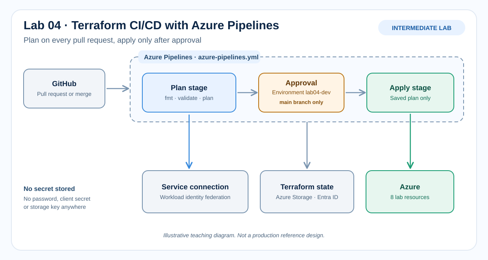

# Lab 04 - Terraform CI/CD with Azure Pipelines

**Level:** Intermediate  
**Technology:** Azure DevOps, Azure Pipelines, Terraform, Azure  
**Focus:** Pipeline as code, remote state, workload identity federation, approval gate  
**Prerequisite:** [Lab 03](../03-module-versioning/README.md)  
**Status:** Ready to run in a lab subscription

## Goal

Until now, you ran every Terraform command yourself, from your workstation. In this lab, a **pipeline** runs them for you: the same commands, in the same order, every time, on a clean machine.

- A **pull request** only checks and plans. Nothing is deployed.
- A **merge to `main`** checks and plans again, then **waits for your approval**, then applies exactly the plan you approved.

The code stays on GitHub. The pipeline runs in Azure DevOps. Azure trusts the pipeline without any password or secret.



## What you build

| Item | Value |
| --- | --- |
| Azure DevOps project | `Terraform DevOps Labs` (any name works) |
| State storage | Resource group `rg-tfstate-lab`, storage account `sttfstate<suffix>`, container `tfstate` |
| Service connection | `Azure-Dev-Test`, Azure Resource Manager, workload identity federation |
| Environment | `lab04-dev`, with a manual approval |
| Pipeline | `azure-pipelines.yml` in this folder |
| Azure resources | `rg-lab04-network-dev-weu-001`, `vnet-lab04-network-dev-weu-001` (`10.40.0.0/16`), 2 subnets, 2 network security groups |

Total in Azure: **8 resources**, deployed by the pipeline. This lab has its own resource group and its own state. It does not touch Labs 01 to 03.

## Learning objectives

1. Explain what a pipeline is, and what the YAML file describes.
2. Store Terraform state remotely, without storage keys.
3. Connect Azure DevOps to Azure with workload identity federation.
4. Separate **plan** (on every pull request) from **apply** (after approval, on `main` only).
5. Apply exactly the plan that was reviewed, not a new one.

## Key ideas

| Idea | Meaning |
| --- | --- |
| Pipeline | The automated process that runs your commands. Defined in YAML, run by Azure DevOps. |
| Stage, job, step | A stage groups jobs, a job runs on one machine, a step is one command or task. |
| Agent | The temporary machine that runs a job. Here, a Microsoft-hosted Ubuntu machine, deleted after the run. |
| Remote state | The Terraform state file stored in Azure Storage, so that every run sees the same inventory. |
| Service connection | How Azure DevOps signs in to Azure. |
| Workload identity federation | Entra ID trusts tokens issued by Azure DevOps for one specific service connection. Nothing to store, nothing to rotate. |
| Environment and approval | A named deployment target. Its approval check pauses the run until a person accepts it. |
| Plan artifact | The saved plan file, passed from the Plan stage to the Apply stage. |

## Part 1 - Prepare the remote state

Run in **PowerShell**, signed in to your lab subscription. The storage account name must be globally unique and lowercase, so a random suffix is added.

```powershell
az login
az account set --subscription "<your lab subscription>"

$rg  = "rg-tfstate-lab"
$loc = "westeurope"
$st  = "sttfstate" + (Get-Random -Maximum 99999)
az group create --name $rg --location $loc
az storage account create --name $st --resource-group $rg --location $loc --sku Standard_LRS --min-tls-version TLS1_2 --allow-blob-public-access false
az storage container create --name tfstate --account-name $st --auth-mode login
Write-Output "Storage account : $st"
```

Expected: `"created": true`, then the storage account name. Write it down and put it in `tfStateStorageAccount` in `azure-pipelines.yml`.

## Part 2 - Connect Azure DevOps to Azure

1. In your Azure DevOps project, open **Project settings**, then **Service connections**, then **New service connection**.
2. Select **Azure Resource Manager**, then **Next**.
3. Credential: **Workload identity federation**. Scope level: **Subscription**, your lab subscription.
4. Resource group: leave **All resource groups**, because Terraform creates its own resource group.
5. Name: `Azure-Dev-Test`, then **Save**.

Azure DevOps creates an app registration in Entra ID, adds a federated credential to it, and grants it **Contributor** on the subscription. The service connection page shows the **Issuer** and **Subject identifier** that Entra ID trusts.

## Part 3 - Give the pipeline access to the state

**Contributor** manages the storage account, but does not read or write the blobs inside it. The backend uses Entra ID authentication (`use_azuread_auth = true`), so the pipeline identity needs a data role.

```powershell
$spId = az devops service-endpoint list --organization https://dev.azure.com/<your organization> --project "<your project>" --query "[?name=='Azure-Dev-Test'].authorization.parameters.serviceprincipalid" -o tsv
$stId = az storage account show --name <your storage account> --resource-group rg-tfstate-lab --query id -o tsv
az role assignment create --assignee $spId --role "Storage Blob Data Contributor" --scope $stId
```

Expected: a JSON role assignment whose scope ends with your storage account name. If `$spId` is empty, the service connection name is wrong or the connection does not exist yet.

## Part 4 - Create the environment and its approval

Do this **before** the first run on `main`. Otherwise Azure DevOps creates the environment automatically, without any approval.

1. Open **Pipelines**, then **Environments**, then **New environment**.
2. Name: `lab04-dev`. Resource: **None**. Select **Create**.
3. In the environment, open the **...** menu, then **Approvals and checks**, then **Approvals**.
4. Add yourself as approver, then **Create**.

## Part 5 - Check that a hosted agent is available

Open **Project settings**, then **Parallel jobs**. Under **Microsoft-hosted**, you need at least one parallel job.

If it shows **0**, request the free grant for your organization with the [Azure DevOps parallelism request form](https://aka.ms/azpipelines-parallelism-request). Approval can take a few working days. Until then, a pipeline run stays queued.

## Part 6 - Create the pipeline

1. Open **Pipelines**, then **New pipeline**.
2. Where is your code? **GitHub (YAML)**. Authorize Azure Pipelines on GitHub when asked, and select this repository.
3. Configure: **Existing Azure Pipelines YAML file**. Branch: the branch that contains this lab. Path: `/labs/04-azure-devops-cicd/azure-pipelines.yml`.
4. Review, then **Save** (in the **Run** menu). Rename the pipeline `Lab 04 - Terraform CI/CD`.

## Part 7 - Pull request: plan only

1. On a branch, make a small change in this folder, for example a new tag value in `variables.tf`.
2. Open a pull request to `main` on GitHub.

Expected: Azure Pipelines runs automatically and reports its status in the pull request. In the run, **Validate and plan** succeeds and **Approve and apply** is **skipped**. Open the **Initialize, validate and plan** step to read the plan.

## Part 8 - Merge: approve and apply

1. Merge the pull request.
2. A new run starts on `main`. After **Validate and plan**, the run shows **Waiting** with a review request.
3. Read the plan in the Plan stage, then select **Review**, then **Approve**.

Expected: `Apply complete! Resources: 8 added` on the first deployment, then `No changes` on a run where the infrastructure code did not change.

## Part 9 - Verify, then clean up

```powershell
az group exists --name rg-lab04-network-dev-weu-001
az resource list --resource-group rg-lab04-network-dev-weu-001 --output table
```

To remove the lab, run `destroy` from your workstation against the **same remote state**. Your own account also needs **Storage Blob Data Contributor** on the state storage account.

```powershell
cd labs/04-azure-devops-cicd
$env:ARM_SUBSCRIPTION_ID = az account show --query id --output tsv
terraform init -backend-config="resource_group_name=rg-tfstate-lab" -backend-config="storage_account_name=<your storage account>" -backend-config="container_name=tfstate" -backend-config="key=lab04-azure-devops-cicd.tfstate" -backend-config="use_azuread_auth=true"
terraform destroy
```

Review the destroy plan before typing `yes`. Expected: `Destroy complete! Resources: 8 destroyed.`

## Success criteria

| Check | Expected result |
| --- | --- |
| Pull request run | Plan succeeds, apply is skipped |
| Run on `main` | Waits for approval before applying |
| First approved run | 8 resources added |
| Next run without infrastructure change | `No changes` |
| State | One blob `lab04-azure-devops-cicd.tfstate` in the `tfstate` container |
| Secrets | None in the repository, the pipeline or the service connection |

## Exercises

Continue with the [guided exercises and challenges](docs/exercises.md).

## Safety and cost

- Nothing reaches Azure without a human approval, and never from a pull request.
- The pipeline identity is **Contributor** on the whole lab subscription. That is acceptable in a dedicated lab subscription. In production, scope it to the resource groups it manages and use a separate connection per environment.
- A plan file can contain sensitive values. It is kept as a pipeline artifact, visible to project members only. Keep the Azure DevOps project private.
- The lab resources carry no direct charge at the time of writing. The state storage account costs a few cents per month. Always check Azure pricing, and remove lab resources when finished.
- Never commit state files, plan files, or `.terraform/`.

> **From the field:** The two rules that make teams trust a Terraform pipeline are simple. First, every change is planned in a pull request, where a reviewer reads the plan, not only the code. Second, the apply uses the saved plan from the same run. If the apply ran a fresh plan instead, a change made in Azure between review and approval could be deployed without anyone having seen it.

## Troubleshooting

| Symptom | Likely cause | Action |
| --- | --- | --- |
| `No hosted parallelism has been purchased or granted` | No Microsoft-hosted parallel job yet | Request the free grant (Part 5) |
| `AuthorizationFailure` or `403` during `terraform init` | The pipeline identity has no data role on the state | Assign **Storage Blob Data Contributor** (Part 3) |
| `--assignee: expected one argument` | `$spId` is empty | Check the service connection name, then run Part 3 again |
| `Saved plan is stale` | The state changed after the plan was made | Run the pipeline again, then approve the new run |
| Run never asks for approval | The environment was created without an approval | Add the approval to `lab04-dev` (Part 4) |
| The pull request run does not start | Path filter, or Azure Pipelines not authorized on the repository | Change a file in this folder; check the GitHub app installation |

## References

- [Connect to Azure with an Azure Resource Manager service connection](https://learn.microsoft.com/en-us/azure/devops/pipelines/library/connect-to-azure)
- [Azure Pipelines YAML schema](https://learn.microsoft.com/en-us/azure/devops/pipelines/yaml-schema/)
- [Create and target an environment](https://learn.microsoft.com/en-us/azure/devops/pipelines/process/environments)
- [Approvals and checks](https://learn.microsoft.com/en-us/azure/devops/pipelines/process/approvals)
- [Azure CLI task, addSpnToEnvironment](https://learn.microsoft.com/en-us/azure/devops/pipelines/tasks/reference/azure-cli-v2)
- [Terraform azurerm backend](https://developer.hashicorp.com/terraform/language/backend/azurerm)
- [AzureRM provider: authenticating with OpenID Connect](https://registry.terraform.io/providers/hashicorp/azurerm/latest/docs/guides/service_principal_oidc)
- [Configure parallel jobs](https://learn.microsoft.com/en-us/azure/devops/pipelines/licensing/concurrent-jobs)
